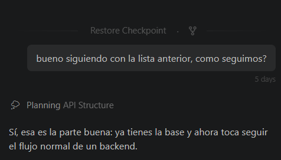
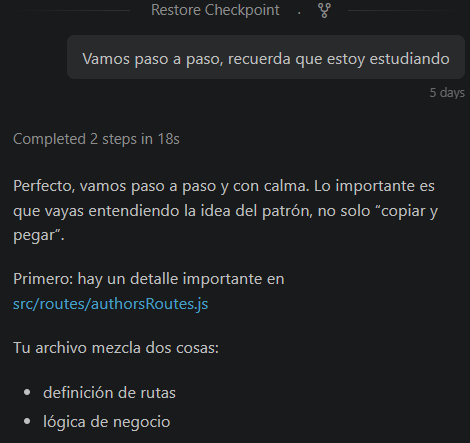
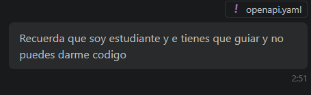
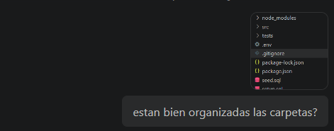

# MiniBlog API

API REST para administrar autores y publicaciones de un blog. Está desarrollada con Node.js, Express y PostgreSQL; permite crear, consultar, actualizar y eliminar registros.

## Tecnologías

- Node.js y Express
- PostgreSQL y `pg`
- Jest y Supertest para pruebas automatizadas
- OpenAPI 3.0.3 para documentar los endpoints

## Requisitos

- Node.js y npm
- PostgreSQL
- Una base de datos local y sus credenciales

## Instalación y configuración local

1. Clona el repositorio y abre una terminal en la carpeta del proyecto.
2. Instala las dependencias:

   ```bash
   npm install
   ```

3. Crea una base de datos PostgreSQL llamada `miniblog`.
4. Crea las tablas y carga los datos iniciales. Desde PowerShell, si PostgreSQL 18 está instalado en la ruta predeterminada:

   ```powershell
   & "C:\Program Files\PostgreSQL\18\bin\createdb.exe" -U postgres miniblog
   & "C:\Program Files\PostgreSQL\18\bin\psql.exe" -U postgres -d miniblog -f ".\setup.sql"
   & "C:\Program Files\PostgreSQL\18\bin\psql.exe" -U postgres -d miniblog -f ".\seed.sql"
   ```

   Si instalaste otra versión o PostgreSQL en otra ubicación, ajusta la ruta a `createdb.exe` y `psql.exe`. Si esos comandos ya están disponibles en `PATH`, también puedes ejecutarlos directamente como `createdb` y `psql`. Crea la base de datos una sola vez; si ya existe, no repitas el primer comando.

5. Copia `.env.example` como `.env` en la raíz del proyecto y configura tus datos locales de PostgreSQL. Reemplaza el valor de `DB_PASSWORD` por tu contraseña:

   ```powershell
   Copy-Item .env.example .env
   ```

   No compartas ni subas el archivo `.env`; está excluido por `.gitignore`. El archivo `.env.example` contiene solo valores de ejemplo y sí debe incluirse en el repositorio.

## Ejecutar la API

Con PostgreSQL iniciado y `.env` configurado, ejecuta:

```bash
npm start
```

La API estará disponible en `http://localhost:3000`. El puerto predeterminado es `3000`; el servidor también puede usar la variable de entorno `PORT`.

## Endpoints

Todas las respuestas usan JSON. En las rutas con `:id` o `:authorId`, reemplaza el parámetro por el identificador correspondiente.

| Método | Ruta | Descripción |
|---|---|
| GET | `/authors` | Lista todos los autores |
| GET | `/authors/:id` | Obtiene un autor |
| POST | `/authors` | Crea un autor |
| PUT | `/authors/:id` | Actualiza un autor |
| DELETE | `/authors/:id` | Elimina un autor |
| GET | `/posts` | Lista todas las publicaciones |
| GET | `/posts/:id` | Obtiene una publicación |
| GET | `/posts/author/:authorId` | Lista las publicaciones de un autor e incluye sus datos |
| POST | `/posts` | Crea una publicación |
| PUT | `/posts/:id` | Actualiza una publicación |
| DELETE | `/posts/:id` | Elimina una publicación |

Para crear un autor, envía `name` y `email`; `bio` es opcional. Para crear una publicación, envía `title`, `content` y `author_id`; `published` es opcional y por defecto es `false`.

La ruta `GET /posts/author/:authorId` responde `404` si el autor no existe. Eliminar un autor también elimina sus publicaciones relacionadas, debido a la clave foránea con `ON DELETE CASCADE`.

## Pruebas

Las pruebas usan Jest y Supertest, y se conectan a la base PostgreSQL configurada en `.env`. Antes de ejecutarlas, inicializa la base con `setup.sql` y `seed.sql`.

```bash
npm test
```

En Windows PowerShell, si `npm` no se reconoce por la política de ejecución, usa:

```powershell
npm.cmd test
```

## Documentación OpenAPI

La especificación OpenAPI se encuentra en [`openapi.yaml`](./openapi.yaml). Puedes abrir el archivo en un editor compatible con YAML u OpenAPI. El proyecto no incluye una interfaz Swagger UI.

## Despliegue en Railway

El despliegue todavía está pendiente. Para publicarlo:

1. Sube el repositorio a GitHub.
2. Crea un proyecto en Railway y conéctalo al repositorio.
3. Agrega una base de datos PostgreSQL en Railway y configura las variables `DB_HOST`, `DB_USER`, `DB_PASSWORD`, `DB_NAME` y `DB_PORT` con los valores proporcionados por ese servicio.
4. Configura el comando de inicio como `npm start` y ejecuta los scripts SQL para crear las tablas y cargar los datos iniciales.
5. Cuando Railway genere el dominio público, reemplaza esta nota con la URL de la API.

No agregues credenciales ni valores privados al repositorio. La aplicación lee la configuración de la base de datos desde variables de entorno.

## Uso de herramientas de IA

Se utilizó una herramienta de IA como apoyo puntual de aprendizaje durante el desarrollo. Las consultas surgieron de problemas y dudas concretas mientras el estudiante implementaba y probaba el proyecto. El estudiante revisó las sugerencias y comprobó el funcionamiento; las decisiones y la implementación final son responsabilidad del estudiante.

### Registro de consultas y apoyo recibido

| Situación concreta | Apoyo recibido |
|---|---|---|
| `psql` y `createdb` no se reconocían como comandos en PowerShell. | Se indicó cómo localizar y ejecutar las herramientas instaladas de PostgreSQL para crear la base y ejecutar los scripts SQL. |
| Duda sobre la organización de carpetas y la separación entre rutas y controladores. | Se revisó la estructura existente y se explicó el propósito de separar esas responsabilidades. |
| Errores al conectar las rutas CRUD con PostgreSQL y al ejecutar las pruebas. | Se revisaron los problemas concretos y se comprobó el resultado de las operaciones y de Jest durante el desarrollo. |
| Revisión de secciones y sangría en `openapi.yaml`. | Se revisaron los cambios que el estudiante iba realizando para que la documentación coincidiera con las respuestas de la API. |
| Incorporación de capturas de consultas al README. | Se añadieron las capturas compartidas como evidencia de algunas interacciones reales del proceso. |

Este registro resume algunas situaciones concretas; no es una transcripción literal ni pretende afirmar que el estudiante solicitó que se hiciera el proyecto completo. Las capturas muestran momentos del acompañamiento durante el desarrollo:

#### Planificación y guía paso a paso





#### Preferencias de aprendizaje y organización





Proyecto: Proyecto integrador L2
Estudiante: Eduardo Maciel
Nomnre del proyecto: MiniBlog